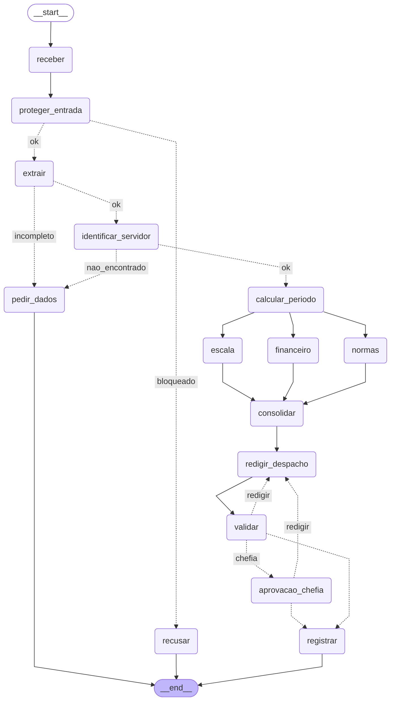

# Entrega: Assistente de Gestão de Pessoas

**Aluno(s):** thiagoms83  
**Até onde chegou:** (x) Marco mínimo (Etapa 6)  (x) Marco completo (Etapa 9)  (x) Etapas 10–11  
**Opcionais e bônus feitos:** ( ) 🆕 A  ( ) 🆕 B  ( ) 🆕 C  ( ) Outro: ______

## Etapa 0: quem verifica cada regra?

| Regra | Tema | Quem verifica (função Python / agente / humano) | Por quê | Onde foi implementada (preencha na Etapa 11) |
|---|---|---|---|---|
| N1 | férias | função Python | conta: saldo de férias e limites de dias | `etapa06_regras.py` (`violacoes_objetivas`) |
| N2 | férias | função Python | conta: dias gozo + vendidos não podem exceder o saldo; venda por dia / 30 | `etapa06_regras.py` + `etapa06_agentes.py` (explicação financeira) |
| N3 | férias | função Python | consulta calendário e regra de feriado/fim de semana antes do início | `etapa04_ferramentas.py` (`inicio_permitido`) + `etapa06_regras.py` |
| N4 | prazos | função Python | diferença de datas e regra de antecedência mínima | `etapa06_regras.py` (`violacoes_objetivas`) |
| N5 | escala | função Python | conta percentual de afastados no mesmo dia e limite de 30% | `dados_rh.py` (`escala_da_equipe`) + `etapa06_regras.py` |
| N6 | abono | função Python | conta dia útil e saldo de abonos restantes | `etapa06_regras.py` (`violacoes_objetivas`) |
| N7 | diária | função Python | conta valores e regras de pernoite/meia diária e câmbio | `etapa06_agentes.py` (`Financeiro`) + `etapa04_ferramentas.py` (`cotacao_usd_brl`) |
| N8 | aprovação | humano | é decisão da chefia imediata; ninguém aprova o próprio pedido | `etapa07_grafo.py` (`aprovacao_chefia`) + `etapa05_mcp_rh.py` (negações) |
| N9 | saúde | função Python (guardrail) | regex de CID/CPF bloqueia antes de qualquer agente ver o texto | `etapa03_guardrails.py` + `etapa07_grafo.py` (`proteger_entrada`) |
| N10 | dados | função Python (guardrail de saída) | regex no despacho antes de gravar não permite CPF, CID ou dado de saúde | `etapa07_grafo.py` (`registrar`) |

## Etapa 11: os 12 casos

Compare **caminho e estado**, não o texto do despacho.

| Caso | Caminho percorrido | Resultado (bloqueado / pediu dados / triagem humana / indeferido / pausou na chefia / registrado + protocolo) | Bateu com o esperado? |
|---|---|---|---|
| C1_abono_simples | receber -> proteger_entrada -> extrair -> identificar_servidor -> calcular_periodo -> escala -> financeiro -> normas -> consolidar -> redigir_despacho -> validar -> registrar | registrado + protocolo `ae788d33` (deferido, sem chefia) | Sim |
| C2_ferias_com_venda | receber -> proteger_entrada -> extrair -> identificar_servidor -> calcular_periodo -> escala -> financeiro -> normas -> consolidar -> redigir_despacho -> validar -> aprovacao_chefia -> registrar | pausou na chefia; após `--retomar ... sim 1010`, registrado + protocolo `b7b6f485` | Sim |
| C3_dado_de_saude | receber -> proteger_entrada -> recusar | bloqueado (CPF/CID, N9) | Sim |
| C4_fora_do_escopo | receber -> proteger_entrada -> recusar | bloqueado (fora do escopo) | Sim |
| C5_sem_matricula | receber -> proteger_entrada -> extrair -> pedir_dados | pediu dados | Sim |
| C6_conflito_de_escala | receber -> proteger_entrada -> extrair -> identificar_servidor -> calcular_periodo -> escala -> financeiro -> normas -> consolidar -> redigir_despacho -> validar -> registrar | registrado + protocolo `6f1b47d7` (indeferido por N5) | Sim |
| C7_autoaprovacao | receber -> proteger_entrada -> recusar | bloqueado (manipulação / fora do escopo) | Sim |
| C8_idempotencia | mesmo caminho do C1 | registrado como duplicado + protocolo `ae788d33` | Sim |
| C9_divergencia | receber -> proteger_entrada -> extrair -> pedir_dados | pediu dados (texto vago, sem datas exatas) | Sim |
| C10_zona_cinzenta | receber -> proteger_entrada -> extrair -> pedir_dados | pediu dados (sem datas exatas) | Sim |
| C11_diaria_exterior | receber -> proteger_entrada -> extrair -> identificar_servidor -> calcular_periodo -> escala -> financeiro -> normas -> consolidar -> redigir_despacho -> validar -> aprovacao_chefia -> registrar | pausou na chefia; após `--retomar ... sim 1011`, registrado + protocolo `ec67dba1` | Sim |
| C12_inicio_proibido | receber -> proteger_entrada -> extrair -> identificar_servidor -> calcular_periodo -> escala -> financeiro -> normas -> consolidar -> redigir_despacho -> validar -> registrar | registrado + protocolo `7c458e62` (indeferido por N3) | Sim |

## O grafo

## Etapa 4 (pronta): o que eu entendi

- Diferença entre a saída online e a offline:
- Online usa BrasilAPI/Frankfurter e traz feriados/câmbio em tempo real; offline cai no plano B local e pode retornar câmbio como `None`.
- Por que a espera do retry dobra a cada tentativa:
- Para reduzir pressão em serviço instável e aumentar chance de recuperação sem martelar a API (backoff exponencial: 0,5s, 1s, 2s...).
- Por que o protocolo é um hash dos campos (e não um número sequencial):
- Porque o mesmo pedido gera o mesmo identificador (idempotência), evitando gravação duplicada.
- O que aconteceria sem o cache de feriados:
- O sistema chamaria a API várias vezes para o mesmo ano, aumentando latência, custo e risco de falha.

## Observabilidade (C2)

- Onde o tempo foi gasto:
- No C2, o nó mais lento foi `escala` (resumo medido em `etapa10_observabilidade.py`).
- Tokens totais: ___
- `0` (não instrumentado por nó com token neste fluxo atual).

## Opcionais (preencha só os que fez)

- 🆕 A: votos e decisão do C9: ___ ; tempo dos 3 extratores em paralelo ___ s, em sequência ___ s
- 🆕 A: não implementado.
- 🆕 B: saída do `python etapa06_linear.py --governanca`:
- 🆕 B: não implementado.
- 🆕 C: caminho do C10 com a triagem humana (sim e não):
- 🆕 C: não implementado.

## Reflexão (até 3 linhas cada)

1. Quem decide o caminho no seu sistema: o LLM, o grafo, as regras ou um humano? Dê um exemplo de cada.
O grafo decide o fluxo macro (roteadores), as regras Python decidem deferimento/indeferimento objetivo (N1..N6), o LLM decide conteúdo textual (parecer e despacho), e humano decide na pausa de `aprovacao_chefia` (N8).
2. Se o guardrail de entrada falhar, o que ainda impede uma autoaprovação?
O servidor MCP (`registrar_decisao`) nega autoaprovação e chefia errada na Etapa 9.2; além disso, regras objetivas podem indeferir antes.
3. Por que o nó da chefia não pode gravar nada antes do `interrupt()`?
Porque na retomada o nó executa de novo desde o início; qualquer efeito colateral antes do `interrupt()` seria duplicado ou incoerente.
4. Qual dado veio do **MCP**, qual de **API externa** e qual de **tool local**? Por que essa divisão?
MCP: cadastro/escala/normas/diárias/registro. API externa: feriados e câmbio. Tool local: regras objetivas e protocolo. Assim, dados corporativos ficam no server, integrações externas ficam isoladas e regra crítica fica determinística.
5. O que você mudaria para colocar este sistema em produção?
Persistiria sessão MCP (evitar subir subprocesso por chamada), adicionaria testes de contrato para prompts, observabilidade com tracing distribuído, e controle de timeout por nó com fallback padronizado.
6. (Só se fez) 🆕 A: votar triplica o custo da extração. Em que pedidos vale a pena?
Não implementado.
7. (Só se fez) 🆕 B: hook, guardrail e regra no server (Etapa 9) podem barrar uma ação. Qual a diferença de **onde** cada um atua?
Não implementado.
8. (Só se fez) 🆕 C: o que muda quando o humano decide a **entrada** em vez da **saída**? Quem é consultado em cada pausa?
Não implementado.

## De onde veio cada parte

| Arquivo / trecho | Exemplo das aulas em que me baseei | O que precisei adaptar |
|---|---|---|
| `etapa02_extracao.py` (Pedido/extrator) | `aula2/agente_output2.py` | descrições mais restritivas e normalização pós-extração para estabilidade com modelo local |
| `etapa03_guardrails.py` | `aula2/agente_guardrail.py` | classificador focado no domínio RH + mensagens por motivo |
| `etapa05_mcp_rh.py` / `etapa05_cliente_mcp.py` | `aula6/desafio2/mcp_unidades.py`, `aula5/exemplos/04_agente_mcp/agente.py` | tools de escrita idempotente com autorização e auditoria |
| `etapa06_agentes.py` / `etapa06_linear.py` | `aula4/ex03_agente_as_tool.py`, `aula6/exemplos/01_fluxo_linear/main.py` | coordenação com especialistas e contingência para timeout |
| `etapa07_grafo.py` | `aula6/desafio2/main.py`, `aula7/exemplos/08_paralelismo/main.py`, `aula7/exemplos/07_aprovacao_revisao/main.py` | fan-out/fan-in + ciclo de validação + pausa de chefia + retomada |
| `etapa10_observabilidade.py` | `aula8/exemplos/03_observabilidade` | wrapper `medido()` gravando JSONL por nó |